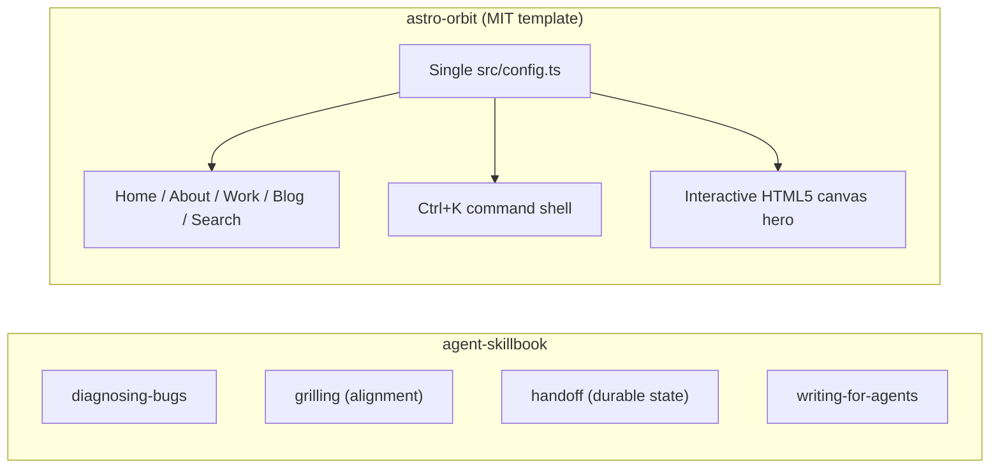

Two open-source repositories focused on reusable engineering structure: one for
how coding agents reason through tasks, and one for fast, zero-framework static
web publishing.

## Workflow & template structure

## Highlights

- **[agent-skillbook](https://github.com/jagarkarlo/agent-skillbook)**: Small,
  self-contained `SKILL.md` playbooks for Claude Code, Codex, and GitHub Copilot
  that prevent common agent failure modes — guessing at bugs before diagnosing,
  building underspecified features without alignment, and losing context across
  handoffs.
- **[astro-orbit](https://github.com/jagarkarlo/astro-orbit)**: MIT-licensed
  Astro 5 + Tailwind v4 portfolio template with Markdown content collections,
  instant client-side search, RSS/sitemap generation, a keyboard-driven command
  shell, and custom canvas physics.
