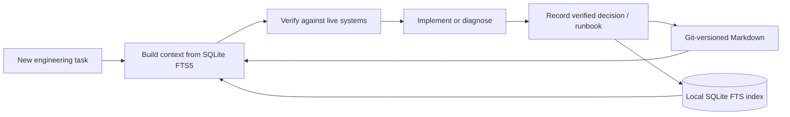

Coding agents lose context between sessions unless verified conclusions are
captured in a form both humans and tools can inspect.

**Copilot Knowledge Base** is a local-only MCP server that stores durable
engineering knowledge as human-readable Markdown files with YAML frontmatter and
indexes them in a local SQLite full-text search database.

## Continuous knowledge loop

## Key capabilities

- **Progressive retrieval**: Supports compact task-context bundles, full-text
  search across kinds (`decision`, `runbook`, `incident`, `fact`,
  `architecture`), freshness tracking (`verifiedAt` / `expiresAt`), and git-backed
  history/revert.
- **Zero external telemetry**: Runs locally over `stdio` on Node.js 22.5+, never
  exposes an HTTP port, and never stores credentials or secret values.
