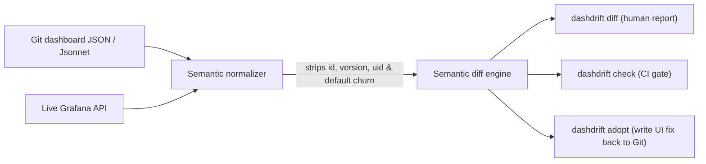

When someone edits a Grafana panel at 2am during an incident to see a metric
more clearly, the fix works and almost never makes it back into Git. Six
months later, Git and production have silently diverged, and raw JSON diffs are
drowned in hundreds of lines of Grafana metadata noise.

**DashDrift** normalizes both sides and reports only **semantic** dashboard
changes.

## Drift normalization & workflow

## What counts as drift vs. noise

- **Reported as drift**: PromQL and LogQL query edits, alert conditions and
  thresholds, datasource identity changes, added or removed panels, template
  variable queries, and unit/threshold updates.
- **Suppressed as noise**: `version`, `id`, and `iteration` increments, key
  reordering, Grafana-injected `fieldConfig` defaults, and cosmetic option
  churn.
