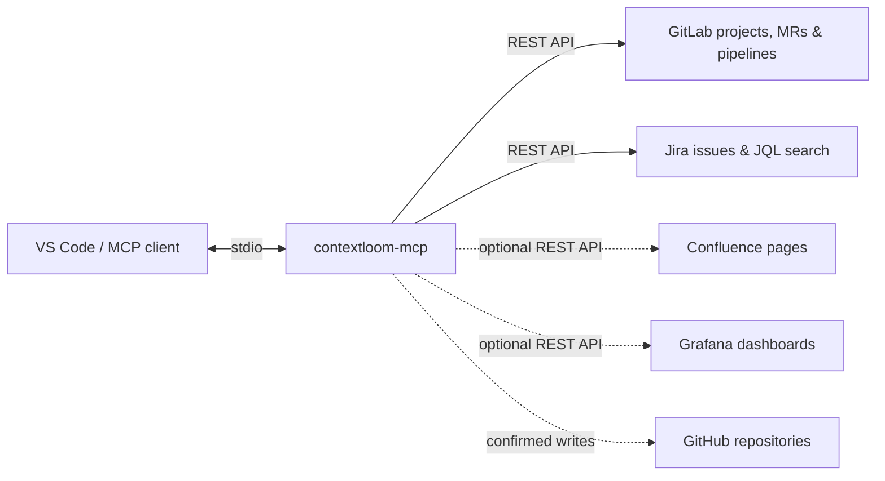

Context plumbing for coding assistants (renamed from `gitlab-jira-context-mcp`),
built on the principle that the default posture is read-only and every write is
deliberate.

## Context flow

The server runs locally over `stdio` and exposes narrowly scoped tools across
GitLab, Jira, Confluence, Grafana, and GitHub. Service tokens remain in the
local `.env` or process environment rather than in MCP messages or source
control.
