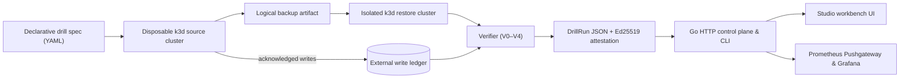

Backup tools report `Completed`. That proves a backup artifact was written — not
that your application can actually be restored from it, that acknowledged writes
survived, or that post-backup policy changes remain intact.

**Nostekon** (coined from the Greek *nóstos*, return, and *tekmḗrion*, conclusive
proof; formerly *Checkride*) verifies recovery evidence and executes disposable
PostgreSQL logical-restore drills across isolated `k3d` clusters. It is being
developed as my master's thesis project (2026–2027) at the Faculty of
Organization and Informatics.

## Verification model (V0–V4)

Most recovery checks stop once pods report `Ready` or tables contain rows.
Nostekon evaluates every drill across five explicit verification levels and
reports both the deepest level passed and the first level that caught a failure:

| Level | Question | Evidence |
| --- | --- | --- |
| **V0** | Did the backup report success? | Backup tool exit status and metadata |
| **V1** | Did the restore report success? | Restore job status on the target cluster |
| **V2** | Is the workload healthy? | Pod readiness, HTTP and TCP probes |
| **V3** | Is the data structurally intact? | Schema tables, row counts, and checksums |
| **V4** | Is the data semantically correct? | Business invariants, external acknowledged-write ledger, and cross-store consistency |

## Drill & evidence architecture

## What is implemented today

- **Declarative drill specifications**: Validated across Python, the Go HTTP API,
  and the TypeScript Studio workbench.
- **External acknowledged-write ledger**: Tracks writes acknowledged before a
  fault outside the cluster failure domain to compute exact RPO rather than
  approximating from backup timestamps.
- **Signed `DrillRun` evidence & CLI tooling**: Bounded JSON evidence documents
  validated against a published JSON Schema, evaluated via `nostekon-report` for
  CI gates, and cryptographically signed/verified with `nostekon-attest`
  (Ed25519 detached signatures).
- **Single-process Studio & Go control plane**: Packaged in a rootless,
  read-only Docker Compose container that serves the Studio UI and Go
  verification API, with optional Prometheus Pushgateway metrics and a bundled
  Grafana dashboard.

## Thesis research direction: Nostekon Guard

Alongside V0–V4 data-recovery verification, the thesis investigates
**Revocation-Aware Recovery Verification for PostgreSQL-Backed Applications in
Kubernetes** (*Nostekon Guard*):

- **The problem**: If Alice had permission to read a document when a backup was
  taken, and that permission was later revoked, restoring the database from
  backup can silently resurrect Alice's revoked access while legitimate current
  grants (Bob) must still work.
- **Approach**: Hold a versioned, temporal authorization contract outside the
  restored database's failure domain and run explicit allow/deny behavioural
  checks against the restored instance — distinguishing genuine policy
  regressions from target unavailability, timeouts, or stale policy evidence.
