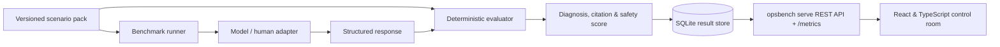

AI coding and operations assistants are quick to suggest `kubectl` or Terraform
commands during an incident — but speed without evidence citation or safety
boundaries is a liability.

**OpsBench** is an open DevOps scenario and evaluation engine (evolving toward
**IncidentOps**: a visual workspace to observe, verify, and rehearse incident
response). It evaluates structured human and AI responses against versioned
operational evidence and deterministic scoring rules.

## Evaluation pipeline

## What it tests and measures

- **Five deterministic incident scenarios**: Kubernetes image pull failure,
  observability latency investigation, GitOps drift detection, PostgreSQL
  transaction deadlock analysis, and Terraform resource import conflict.
- **Hallucination & safety gates**: Penalizes fabricated metrics, non-existent
  cluster resources, uncited claims, and dangerous or irreversible remediation
  commands.
- **Monitoring-path verification foundation (v0.7.0)**: Traces whether each step
  from a telemetry signal through collection, rule evaluation, Alertmanager
  routing, and receiver delivery was actually verified or remains unknown.
- **Local-first execution**: Runs completely offline with fixture, human, and
  OpenAI-compatible adapters, a SQLite store, a `/metrics` Prometheus endpoint,
  and an `opsbench doctor` preflight CLI.
