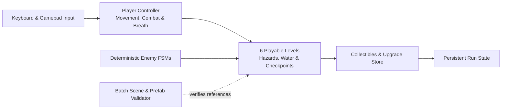

Developed as the practical part of my bachelor's thesis at the Faculty of
Organization and Informatics (*"Izrada retro platformera u programskom alatu
Unity"*), **QuantumQuarry** is a complete six-level 2D platformer rather than a
prototype.

## Game architecture & validation

## Systems highlights

- **Six complete levels**: Movement, melee and ranged combat, environmental
  hazards, water and breath-scaling mechanics, checkpoints, and boss/enemy
  encounters.
- **Deterministic enemy state machines**: Reproducible patrol, chase, and attack
  transitions so enemy behaviour can be reasoned about and tested.
- **Automated batch validation**: Editor validation scripts that inspect scene
  wiring, prefab references, and level progression before builds.
