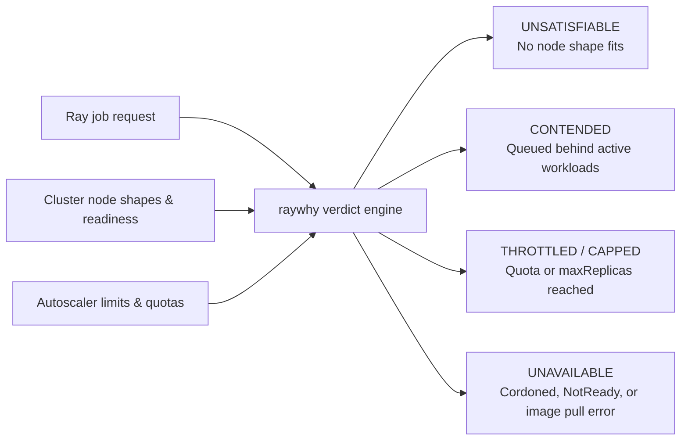

Ray's dashboard shows **state**, not **causality**. When a job sits in `PENDING`
on a shared multi-tenant KubeRay cluster, the usual advice is "go read the
autoscaler logs and `kubectl describe` output side by side."

**raywhy** is a read-only diagnostic engine that inspects job resource requests,
cluster node shapes, and autoscaler state to return an explicit verdict and
remedy.

## Diagnostic flow

## Design boundaries

- **Strictly read-only**: Never schedules, preempts, evicts, or mutates cluster
  resources, and requires no in-cluster agent or sidecar.
- **Deterministic verdict engine**: Evaluates normalized cluster snapshots via
  `raywhy job <id> --snapshot <file>` (with human-readable and `--json` output)
  so every classification is unit-tested against reproducible multi-tenant
  fixtures.
