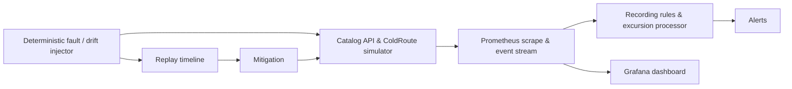

Incidents and telemetry streams you can replay on demand. The faults and sensor
excursions are synthetic and deterministic, which makes the resulting signals a
verifiable engineering tool rather than a guess.

## Incident & telemetry loop

The labs ([portfolio-ops-lab](https://github.com/jagarkarlo/portfolio-ops-lab)
and [coldroute-platform](https://github.com/jagarkarlo/coldroute-platform)) keep
the causal chain visible: emit seeded telemetry or inject a known fault, observe
the API and metric signals, inspect the recorded availability and latency
series, mitigate, and verify recovery in the same local stack.
